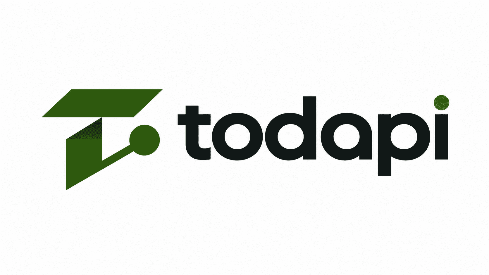

<p align="center">
  <a href="https://scream.chat">
    
  </a>
</p>

<p align="center">A 24-hour personal agent on your own computer or server: it writes code, runs tasks, schedules work, and gets better the longer you use it.<br/>Runs locally, with zero remote data behavior.</p>

<p align="center">
  <a href="https://www.npmjs.com/package/scream-code"></a>
  <a href="https://github.com/LIUTod/scream-code/stargazers"></a>
  <a href="https://github.com/LIUTod/scream-code/blob/main/LICENSE"></a>
</p>

<p align="center">
  <a href="README.md">English</a> |
  <a href="README.zh.md">简体中文</a>
</p>

### ❤️Sponsor

<details open>
<summary>Click to collapse</summary>

<table>
<tr>
<td width="210" align="center" valign="middle"><a href="https://todapi.work"></a></td>
<td>

<p><strong>todapi</strong> — a high-value API gateway.</p>
<p>DeepSeek and other mainstream models from <strong>as low as 10% of list price</strong>, reached through one unified gateway: pay-as-you-go, one API key for multiple models. Powered by tier-one vendor resources with stable routes and strong value.</p>
<ul>
<li><strong>Price</strong>: DeepSeek and more from 10% of list price</li>
<li><strong>Access</strong>: one gateway, one key — switching models no longer means switching providers</li>
<li><strong>Get started</strong>: sign up at <a href="https://todapi.work">todapi.work</a></li>
</ul>
<p>Thanks to <a href="https://todapi.work">todapi</a> for sponsoring this project ❤️</p>

</td>
</tr>
</table>

</details>

---

### Installation

```bash
npm install -g scream-code
```

> [!NOTE]
> Requires **Node.js >= 22.19**. Git is recommended (background coding works in git worktrees, and the self-review's change history is a git repository). The same command installs and updates. No native build steps and no dependency install scripts: the local embedding engine runs on WebAssembly.
> The first use of the knowledge/memory vector features downloads a ~53MB model into `~/.scream-code/cache` (progress is shown, and the download verifies its checksum before use).

### Quick Start

```bash
scream                    # terminal UI
scream --auto             # auto permission mode
scream -y                 # auto-approve mode
scream -C                 # continue the last session in this folder
scream -p "fix the lint"  # run one prompt without the UI and exit
```

On first launch Scream walks you through model setup (`/config`: the shortcut provider directory, a custom DIY setup, or image generation). 130+ providers are built in, or point it at any OpenAI-compatible endpoint with `/config diy`. Switch models anytime with `/model`, no restart needed; `/model diy` gives each sub-agent its own model, so every model does what it does best.

When Scream wants to modify files or run commands, an approval panel pops up: pick a number, press Enter.

Work you hand over keeps going after you close the terminal; run `/service` once if it should also come back after the computer restarts (an always-on machine, or with Feishu/WeChat set up).

### What it does for you

Scream is a personal agent you install on your own computer or server. Coding is its trade, and it also runs your routine work, schedules things and gets better the longer you use it.

| Scenario | How |
|---|---|
| **Coding overnight** | In the evening say "fix the flaky tests until they pass five times in a row" and close the terminal. It works in its own git worktree, never in your checkout; before anything irreversible, such as `git push`, it asks you on your phone. In the morning you read the branch and the result. |
| **Routine work** | "Check CI every weekday at 9 and tell me if something is wrong." Jobs run on time by themselves and results go to your Feishu or WeChat; `/brief` in the chat adds a few-sentence brief every morning at 08:30. |
| **Power loss** | The power goes out or the machine restarts mid-task. After you log in it carries on by itself; you touch nothing. |
| **Gets better** | Turn on the weekly self-review in `/jobs` and every Monday it reviews itself: which tool calls kept failing this week, which skills nobody used. It proposes improvements, and every change is recorded and can be rolled back. |

### Resident and background

- **Works without Feishu or WeChat** — with jobs on, opening a terminal starts the background, which keeps running after the terminal closes until the computer restarts. Opening a terminal tells you what happened while you were away, the footer shows `◆ 1 waiting` when something needs you, the sidebar's first panel (Jobs) lists each job's last result and next run, and a system notification pops up when something waits for you, a job fails or handed-over work is done.
- **Resident service (`/service`)** — makes the background start again after a restart: installs the background host as a per-user service: a LaunchAgent on macOS, a systemd user unit on Linux (install turns on lingering so it starts at boot without a login; where that needs a password it tells you to run `sudo loginctl enable-linger`), a logon task on Windows. No administrator rights; it restarts after a crash (and stops retrying if it keeps crashing), and moves to the new version by itself once it is idle after an update. Turning it on checks, with the service's own environment, that the background can reach the model (`scream host check`), and says what to do when it cannot — a key kept only in your shell profile is the usual reason. While work runs on mains power it keeps the computer from idling into sleep (a laptop still sleeps with its lid closed).
- **Session reminders** — with Feishu or WeChat set up, the chat hears when a session needs you: done, waiting for an approval or an answer, or failed. That covers sessions the background runs, and a terminal's sessions once you have been away from that terminal for 3 minutes. Each names the session, its project and what to do next, never the conversation; several at once arrive as one message. `/line` → 会话提醒 chooses which (or off).
- **Rides out outages** — a goal or a bot run whose model requests fail because the network is down (a laptop that just woke) or the provider is overloaded keeps trying for up to 30 minutes instead of stopping; a background job that hits a timeout runs again 15 minutes later before it counts as failed.
- **Hand off and take over** — quitting while a goal runs asks whether to hand it to the background; opening a session the background is working on lets you take it over. A session is open in one process at a time, so nothing gets written twice.
- **Background jobs (`/jobs`)** — a job says four things: what to do, when it starts (once, or on a cron schedule), whether it acts or only reports, and until when (always, a date, or an outcome). Each run gets a fresh session that stays out of `/sessions`; the last run's conclusion is passed to the next as notes. The agent can schedule jobs itself (at most every 15 minutes, 20 enabled at once); ten failures in a row switch a job off and tell you.
- **Coding in worktrees** — a job that acts works in its own worktree under `~/.scream-code/worktrees/`, on a branch `scream/<job>/<date-time>`, and the host commits its changes there afterwards. Your checkout is never touched; a run that changed nothing leaves no branch.
- **Waiting for you** — what unattended work could not decide alone (a refused action, a question) is shown at the top of `/jobs` with a system notification, and pushed to your chat when one is set up. It does not wait meanwhile; it carries on with other work. In the chat just reply "同意" (approve), "拒绝" (reject) or "以后都同意" (always); pushes of background-job branches approved once are allowed from then on. An approval lets exactly that action through once, still through every permission check. Items expire after 24 hours and are noted in the brief.
- **Daily brief and report** — turn it on with `/brief` in the chat: every day at 08:30, a few sentences on what background work did, what failed and what waits for you; a morning with nothing to report sends nothing. Anytime, `scream report --since 24h` shows the same from local data, without calling a model.
- **Daily token limit** — set a daily token limit on unattended work in `/service`; once reached, work waits for the next day.
- **Stop everything** — `/jobs stop` in the terminal, `/stop all` in the chat, `scream host pause` from the shell.

### Features

- **Goal Loop** — autonomous, goal-driven execution with an independent judge agent. Rejections must name concrete gaps; evidence gaps self-repair for up to 3 rounds, subjective calls park for your decision (with a written report), and round/token/time budgets bound the loop.
- **Bot Mode (`/bot`)** — unattended execution: reversible work (reads, in-workspace edits, read-only commands, tests and builds) runs freely; irreversible actions (push / publish / delete / sensitive files / unclassified commands) are refused and land in "waiting for you". The model is told why, does not retry blindly, and finishes the rest first.
- **Wolfpack** — unlimited parallel sub-agents (coder / explore / plan / verify / reviewer / oracle / worker / writer / designer).
- **Subagent Collaboration** — delegate to specialist sub-agents and stay in control: they **ask the lead agent for guidance instead of guessing when blocked**, request a handoff when a different specialist fits, take mid-task redirects, return structured JSON when asked, and can be confined to read-only / edit-only / commands-allowed.
- **Self-evolution** — three parts:
  - **Weekly self-review**: a built-in background job that looks at numbers only, never at conversations, and proposes at most three improvements (a new skill, a skill change, tidier memories, a plugin), each naming the sessions it came from. By default it only proposes; once you allow it, it makes small changes itself. Deleting skills, writing memories and enabling plugin code always ask you; permissions, budgets and configuration are out of its reach.
  - **Change history**: every change to skills and memories is recorded in `~/.scream-code/evolution` (git); see the diff and roll back any single change from Change history in `/skills`, or `/memory history`.
  - **Plugins**: the built-in `ManagePlugin` tool lets the agent find, make and install skills and MCP servers and hot-apply them to the running session. Nothing executes until an approved activate, a circuit breaker removes a plugin after repeated failures, it warns before reinstalling a source that broke before, and upgrades keep a rollback backup.
- **Persistent Memory** — structured experience memos (what was tried, what worked, what failed) with FTS5 full-text + tag + vector retrieval, shared across sessions. When an earlier session's experience clearly bears on what you ask, it comes back on its own — quietly, as a hint the agent checks against the code — and the agent tells you when it changed the plan; say "remember this" to save one. Memories written unattended need your approval first.
- **Local Knowledge Graph** — a visual knowledge base based on SAG ([arXiv:2606.15971](https://arxiv.org/abs/2606.15971)) for multi-hop reasoning; import your own documents anytime.
- **RLM Mode** — a persistent Python workspace for long tasks; `rlm()` spawns recursive sub-agents straight from code, always through the `coder` profile, unlimited by default and capped with `/rlm-max-depth`. Every `rlm()` call is a real sub-agent run and consumes tokens.
- **Script Mode** — on by default: the model runs JavaScript in a sandbox that calls the other tools for it, so batch work over dozens of files or pages finishes in one round trip and only the summary enters the conversation; `/script` toggles it.
- **TUI Sidebar** — Jobs (whether the background runs, what waits for you, each job's last result and next run), per-session token accounting (cache hit / miss / output), 9 sub-agent slots with live states, Goal and judge state, and a network panel (probed only while the sidebar is visible, every 30 seconds). `Ctrl+X` toggles it.
- **Session Trace `/trace` and Search `/search`** — export a session as an offline, interactive HTML timeline; full-screen keyword search over the conversation.
- **High Cache Hit Rate** — per-session HitR in the status bar, tuned across compatible protocols to maximize cache hits without lowering quality.
- **MCP / Skills / 130+ providers** — all DIY-configurable; ships with browser automation and macOS desktop automation; when a language server is missing, it names the command that installs it.
- **Feishu and WeChat** — the native `/line` channel: text, images, files and voice both ways. From the chat: `/status`, `/model`, `/compact`, `/stop`, `/new`, plus `/jobs`, `/brief` (daily brief), `/project` (switch this chat's project), `/inbox`, `/approve` and `/stop all`; and session reminders come to the chat.

### Slash Commands

Type `/` in the input to browse all 59 commands:

<details>
<summary>Full command reference (click to expand)</summary>

| Command | Description |
|---------|-------------|
| **Modes & execution** | |
| `/auto` | Toggle auto permission mode |
| `/yes` (`/yolo`) | Toggle auto-approve mode |
| `/ask` | Toggle read-only Q&A mode |
| `/bot` | Unattended mode: reversible actions run, irreversible ones are refused and land in "waiting for you" |
| `/goal [objective]` (`/goaloff`) | View/manage auto goals (goal-driven loop) |
| `/wolfpack` (`/wp`) | Toggle wolfpack mode: auto-approve + batch concurrency |
| `/rlm` | RLM mode: persistent Python workspace; `rlm()` spawns real recursive sub-agents |
| `/rlm-max-depth [N]` | Show or set the RLM recursion depth limit (0 = unlimited, the default) |
| `/script` | Script mode: run JavaScript in a sandbox that batches tool calls (on by default) |
| `/plan` | Toggle plan mode |
| `/fusionplan` (`/fp`) | Fusion plan mode (multi-agent parallel planning) |
| `/btw` | Ask a quick question without interrupting the conversation |
| `/eval` | Run end-to-end tests (agent health check) |
| **Resident & background** | |
| `/service` | Resident service: on/off, status, keep awake, daily token limit |
| `/jobs` (`/cron`) | Background jobs, this session's reminders, waiting for you: list, create, pause, delete, turn on the weekly self-review |
| `/tasks` (`/task`) | Browse background commands and sub-agents running in this session |
| `/line` | Feishu & WeChat channels: setup wizard |
| **Session** | |
| `/new` (`/clear`) | Start a new session in this workspace |
| `/sessions` (`/resume`) | Browse and restore sessions |
| `/compact` | Compact conversation context |
| `/fork` | Copy the session into a new branch |
| `/title` (`/rename`) | Set or show the session title |
| `/revoke [N]` | Undo the last N conversation rounds |
| `/export-md` (`/export`) | Export the session as Markdown |
| `/export-debug-zip` | Export the session as a debug ZIP |
| `/status` | Show session and runtime status |
| `/usage` | Show token usage and context window |
| `/budget` | Set a token limit for this session |
| **Memory & knowledge** | |
| `/memory` (`/memo`, `/mem`) `[query]` | Browse, search, inject memory memos; `/memory history` shows the change history |
| `/knowledge` (`/know`) `[query]` | Manage the local knowledge base (ingest / search / delete / stats) |
| **Models & configuration** | |
| `/model [alias]` | Switch model |
| `/config` (`/login`) | Configure model services: quick pick, custom DIY setup, or image generation (`/config image`) |
| `/logout` (`/disconnect`) | Remove configured models |
| `/language` (`/lang`) | Switch interface language |
| `/theme` | Set the terminal UI theme |
| `/permission` | Select permission mode |
| `/grants` | Review and revoke session approvals |
| `/editor` | Set external editor |
| `/settings` | Open UI settings |
| `/like` | Set your preferences (nickname, tone, more) |
| `/init` | Analyze the codebase and generate AGENTS.md |
| `/update` | Update to the latest version |
| `/version` | Show version info |
| **Extensions** | |
| `/plugin` (`/skills`, `/plugins`) | Skill center: activate, install, uninstall; Change history at the bottom |
| `/extension` | Code extensions: activate or deactivate a plugin entry point |
| `/make-skill` | Distill this session's approach into a skill |
| `/mcp` | Manage MCP servers (install / disable / uninstall) |
| **Interface & tools** | |
| `/search` | Search the conversation (same as `Ctrl+Shift+F`), Esc to close |
| `/trace` | View the session working trajectory |
| `/sidebar` (`/sb`) | Open/close the sidebar (`Ctrl+X`) |
| `/hl` (`/highlight`) | Toggle the user-message highlight block |
| `/blockrows` (`/rows`) | Adjust activity block rows (collapsed height / tool-result rows / reasoning rows) |
| `/codebg` (`/codeblock`) | Toggle the background behind code blocks |
| `/mermaid` (`/diagram`) | How mermaid blocks render: box-drawing frames / ASCII frames / source |
| `/snaptimer` (`/timer`) | Toggle the per-turn elapsed timer |
| `/copy` (`/yank`) | Copy the last reply to the clipboard |
| `/help` (`/h`, `/?`) | Show commands and shortcuts |
| `/hotkeys` (`/keys`) | Keyboard shortcut reference |
| `/exit` (`/quit`, `/q`) | Exit |

Skills work as commands too: `/skill:<name>`. For example, after image setup, `/image` or just ask for a picture.

</details>

**Shortcuts:** `Ctrl+S` interrupt · `Ctrl+C` cancel · `Ctrl+O` expand tool output · `Ctrl+Shift+F` search · `Ctrl+X` sidebar · `Shift+Tab` plan mode · `Shift+Enter` new line · `Tab` (empty input) cycle thinking effort · `@` mention a file

### Command line

```
scream [options]                    terminal UI; -p runs one prompt and exits, -C continues, -S picks a session
scream service [install|uninstall|status|restart|logs]
                                    resident service: start the background host at login
scream host [start|stop|status|restart|pause|run|check]
                                    the background host itself; pause stops all background work; check: can it reach the model
scream report [--since 24h]         what background work did: job runs, what waits for you, tokens today
scream line [start|stop|status|restart]
                                    Feishu/WeChat channel (the same process as scream host)
scream export [sessionId]           export a session as a ZIP
```

### Documentation

Website: [scream.chat](https://scream.chat)

- **Background host & resident service** — `/service`, `/jobs`, waiting for you, weekly self-review and change history: [`docs/host.md`](docs/host.md)
- **Feishu & WeChat channels** — the `/line` wizard and the commands available in the chat: [`docs/line.md`](docs/line.md)
- **Configuration** — providers, model aliases and image generation: [`docs/configuration.md`](docs/configuration.md)
- **Skills** — skill packages, discovery, `/skill:<name>` and change history: [`docs/skills.md`](docs/skills.md)
- **Plugins** — the agent writing plugins for itself: [`docs/plugins.md`](docs/plugins.md)
- **MCP** — external tool servers: [`docs/mcp.md`](docs/mcp.md)
- **Sessions** — storage, resume, fork and export: [`docs/sessions.md`](docs/sessions.md)
- **Architecture** — package layout and prompt assembly: [`docs/architecture.md`](docs/architecture.md)
- **Plugin self-evolution manual** — making, installing, activating, tripping and rolling back a plugin, end to end: `packages/agent-core/docs/self-evolution-e2e.md`

### Contributing

Free and open — forks, feedback and pull requests are welcome. Scream is a lightweight agent foundation: maximize the model's own capability, don't over-constrain it with framework. Inspired by the wider agent-tooling community.

---

<p align="center">
  <a href="https://github.com/LIUTod/scream-code">GitHub</a> · <a href="https://scream.chat">scream.chat</a> · <a href="LICENSE">MIT License</a> · Made with ❤️ by <a href="https://github.com/LIUTod">LIUTod</a>
</p>
