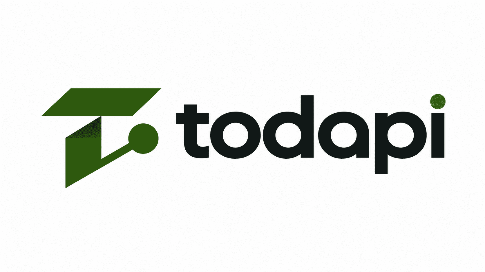

<p align="center">
  <a href="https://scream.chat">
    
  </a>
</p>

<p align="center">装在你自己电脑或服务器上的 24 小时个人 Agent：写代码、跑任务、安排工作，越用越会干。<br/>本地运行，无任何远程数据行为。</p>

<p align="center">
  <a href="https://www.npmjs.com/package/scream-code"></a>
  <a href="https://github.com/LIUTod/scream-code/stargazers"></a>
  <a href="https://github.com/LIUTod/scream-code/blob/main/LICENSE"></a>
</p>

<p align="center">
  <a href="README.md">English</a> |
  <a href="README.zh.md">简体中文</a>
</p>

### ❤️赞助商

<details open>
<summary>点击折叠</summary>

<table>
<tr>
<td width="210" align="center" valign="middle"><a href="https://todapi.work"></a></td>
<td>

<p><strong>todapi</strong> —— 高性价比的 API 网关服务。</p>
<p>DeepSeek 等主流模型<strong>低至 1 折起</strong>，通过统一网关接入：按量计费、充值即用，一个 API Key 覆盖多个模型。使用一级渠道厂商资源，线路稳定，性价比高。</p>
<ul>
<li><strong>超低价格</strong>：DeepSeek 等模型低至官方价 1 折起</li>
<li><strong>统一接入</strong>：一个网关、一个 Key，切换模型不用换服务商</li>
<li><strong>即刻上手</strong>：前往 <a href="https://todapi.work">todapi.work</a> 注册即可使用</li>
</ul>
<p>感谢 <a href="https://todapi.work">todapi</a> 对本项目的赞助 ❤️</p>

</td>
</tr>
</table>

</details>

---

### 安装

```bash
npm install -g scream-code
```

> [!NOTE]
> 要求 **Node.js >= 22.19**，建议安装 Git（后台改代码用的 worktree、自查的改动历史都靠它）。安装与更新是同一条命令；无需本地编译，也不执行依赖的安装脚本，向量引擎跑在 WebAssembly 上。
> 首次使用知识库/记忆的向量功能时，会自动下载约 53MB 的模型到 `~/.scream-code/cache`（有进度显示，校验哈希后才启用）。

### 快速开始

```bash
scream                 # 终端界面
scream --auto          # 自动权限模式
scream -y              # 自动批准模式
scream -C              # 接着当前目录上一次的会话
scream -p "修好 lint"  # 不进界面，跑一句就退出
```

首次启动会进入模型配置向导（`/config`：快速选择 / 自定义 / 生图配置）。内置 130+ 模型商，也可以用 `/config diy` 指向任意 OpenAI 兼容端点。之后用 `/model` 随时切换，不用重启；`/model diy` 还能给子 Agent 单独配模型，让每个模型做它最擅长的事。

它要改文件或执行命令时，会弹出审批面板：按数字键选择，回车确认。

交给后台的工作，关掉终端也会接着做；想让它在电脑重启后也自己起来（一直开着的机器，或配了飞书/微信时），运行一次 `/service`。

### 它能替你做什么

Scream 是一个装在你自己电脑或服务器上的个人 Agent：以写代码为本行，也能替你跑日常任务、安排工作，并且越用越会干。

| 场景 | 怎么用 |
|---|---|
| **夜里改代码** | 晚上说"把 flaky 测试修好，直到连续 5 次通过"，然后关掉终端。它在独立的 git worktree 里干活，不碰你的工作目录；要 `git push` 这类不可逆的事，先推到手机上问你。早上看分支和结果。 |
| **日常任务** | "每个工作日 9 点检查 CI，有问题再告诉我"。任务到点自己跑，结果发到你的飞书或微信；在聊天里发 `/brief`，每天 08:30 还会收到一份几句话的简报。 |
| **断电续跑** | 活干到一半断电或重启，登录后它自己接着干，你什么都不用碰。 |
| **越用越会干** | 在 `/jobs` 里开启每周自查，每周一自查一次：看一周里哪些工具调用总出错、哪些技能没人用，提出改进；改动都记下来，可以一键回滚。 |

### 常驻与后台

- **不配飞书/微信也能用** — 有开着的任务时，打开终端就会把后台拉起来，关掉终端照样跑到电脑重启；打开终端时提示"你不在时"后台做了什么，有事等你时底部状态栏显示 `◆ 待处理 1`，会话状态侧边栏显示下次运行时间，有事等你、任务失败、交给后台的活干完时弹系统通知。
- **常驻服务（`/service`）** — 让后台在电脑重启后也自己起来：把后台服务装成系统的用户服务：macOS 是 LaunchAgent，Linux 是 systemd 用户服务（安装时自动开启 linger，开机即启动、不必登录；需要密码开不了时会提示你运行 `sudo loginctl enable-linger`），Windows 是登录时运行的计划任务。不需要管理员权限，崩溃自动重启（反复崩溃就不再重启，并告诉你），升级后等它闲下来自动换到新版本。开启时会用服务自己的环境检查后台能不能连上模型（`scream host check`），连不上会告诉你怎么办——最常见的原因是密钥只写在 shell 配置里。任务运行期间，只要接着电源，就不让电脑因空闲睡着（笔记本合盖照样会睡）。
- **会话提醒** — 配了飞书/微信时，会话需要你的时候聊天里会收到一条：做完了、在等你批准或回答、没做完。包括后台跑的会话，以及你离开终端 3 分钟以上时那个终端里的会话。只说是哪个会话、哪个项目、下一步怎么做，不带对话内容；同时发生的几件事合成一条。在 `/line` → 会话提醒 里选范围或关闭。
- **断网也不白做** — 目标或 bot 模式的工作遇到断网（笔记本刚开盖）、模型超时或服务商过载时，会继续重试最多 30 分钟，不会直接停下；后台任务遇到超时，15 分钟后再跑一次才算失败。
- **交给后台、接管** — 退出终端时目标还在跑，会问你要不要"交给后台继续"；打开一个后台正在做的会话，可以一键接管。同一个会话同一时刻只有一个进程能打开，不会写乱。
- **后台任务（`/jobs`）** — 一个任务写清四件事：做什么、什么时候开始（一次或按 cron 重复）、动手做还是只汇报、到什么时候为止（一直、到某个时间、或达成某个结果）。每次运行新开会话，不会挤进 `/sessions`；上一次的结论会作为笔记带给下一次。agent 自己也能建任务（最短 15 分钟一次，最多同时开 20 个）；连续失败 10 次的任务自动停用并告诉你。
- **改代码用 worktree** — 动手做的任务在 `~/.scream-code/worktrees/` 下的独立 worktree 里干活，分支名 `scream/<任务>/<日期-时间>`，跑完由后台提交到这个分支。你白天的工作目录不会被碰；什么都没改就不留分支。
- **待你处理** — 无人值守时被拦下的操作和它想问你的问题，会显示在 `/jobs` 第一行、弹系统通知，配了飞书/微信再推到聊天。它不停下来等你，先去做别的。聊天里直接回"同意"、"拒绝"、"以后都同意"就行（推后台任务分支这类，同意一次以后都放行）；同意后只放行这一个完全相同的操作一次，仍然走完整的权限检查。24 小时没人处理就作废，写进简报。
- **每日简报与报告** — 在聊天里发 `/brief` 开启：每天 08:30 推几句话：后台做了什么、失败了什么、等你处理什么；没事可报的早上不发。随时也可以运行 `scream report --since 24h`，直接读本机数据，不调用模型。
- **每日 token 上限** — 在 `/service` 里给无人值守的工作设一个每天的 token 上限，到了就停到第二天。
- **一键全停** — 终端里 `/jobs stop`、IM 里 `/stop all`、命令行 `scream host pause`。

### 核心特性

- **Goal Loop** — 目标自主驱动，独立裁判 Agent 裁决：**打回必须指出具体缺口**；缺证据可自动修（上限 3 轮），主观事项直接挂起等你决策（附书面报告）；支持轮次/Token/时间预算控制。
- **Bot 无人值守模式（`/bot`）** — 可逆操作（读、工作区内改代码、只读命令、测试和构建）自动执行；不可逆操作（推代码 / 发布 / 删除 / 敏感文件 / 未分类命令）自动拒绝，并进"待你处理"等你决定。模型知道被拒的原因，不会盲目重试，而是先做完其余部分。
- **Wolfpack 群狼模式** — 无限制并行子 Agent（coder / explore / plan / verify / reviewer / oracle / writer / worker / designer）。
- **子代理协作** — 把任务交给专职子代理，运行中也能随时指挥：**受阻时会主动找主 Agent 商量而不是瞎猜**，需要时请求换人接手；支持发送即时调整、要求 JSON 结构化输出；可限制为「只读 / 仅编辑 / 可执行命令」，防止越权。
- **自进化** — 三件事合起来：
  - **每周自查**：内置的后台任务，只看统计数字、不读对话，每次最多提 3 条改进（新技能、改技能、整理记忆、插件），写明来自哪几个会话；默认只提建议，你允许后小改动才直接做。删技能、写记忆、启用插件代码一律先问你；权限策略、预算、配置它永远改不了。
  - **改动历史**：技能和记忆的每次改动都记在 `~/.scream-code/evolution`（git），在 `/skills` 的"改动历史"或 `/memory history` 里看差异、单条回滚。
  - **插件**：内置 `ManagePlugin`，Agent 能自己检索、自制、安装技能与 MCP 服务器，装入即对当前会话生效；代码入口要单独批准才激活，反复出错自动摘除，重装出过事的来源前会提醒，升级保留回滚备份。
- **永久记忆备忘录** — 结构化提取经验（试过什么、什么有效、什么失败），FTS5 全文 + Tag + 向量三重检索，跨会话共享。以前的经验和你现在问的明显相关时会自己想起来：安静地作为参考、先对照代码核实，改变了做法时会告诉你；说一句"记住这个"就能存一条。无人值守时写记忆要先经你同意。
- **本地 SAG 知识图谱** — 基于 SAG 论文（[arXiv:2606.15971](https://arxiv.org/abs/2606.15971)）的可视化知识库，提升多跳推理，随时导入本地资料。
- **RLM 模式** — 面向长任务的持久 Python 工作环境，状态跨调用保留；`rlm()` 直接由代码派生递归子代理（固定走 coder profile），深度默认无限、可用 `/rlm-max-depth` 限制。每次 `rlm()` 都是真实的子代理运行，会消耗 token。
- **脚本模式** — 默认开启：模型在沙箱里跑 JavaScript 批量调用其他工具，几十个文件/页面的活一次跑完，只有汇总结果进入对话；`/script` 切换。
- **会话状态侧边栏** — 无边框的一整列：按天的 token 用量年历热力图（数字从你自己的会话日志里统计，存在 `usage-ledger.json`，首次打开时在后台补算历史）、今日/近 7 天/近 30 天、缓存命中、活跃天数和连续天数、模型首字延迟及趋势、下一个后台任务、本会话数字、在跑的 Agent 与目标、近 30 天各模型占比。宽度跟着终端走，终端不够高时用鼠标滚轮滚动。`Ctrl+X` 或 `/sidebar` 开关。
- **会话轨迹 `/trace`、上下文搜索 `/search`** — 把会话导出为离线的交互式 HTML 时间轴；全屏关键词搜索当前对话。
- **高缓存命中率 HitR** — 状态栏显示会话级命中率，适配多种兼容协议，在不降低效果的前提下尽量提高缓存命中。
- **MCP / Skill / 130+ 模型商** — 全部可 DIY 配置；内置浏览器自动化与 macOS 桌面自动化；缺语言服务器时，会直接给出安装命令。
- **飞书、微信远程** — 原生 `/line` 通道：文字、图片、文件、语音双向收发。在聊天里可以用 `/status`、`/model`、`/compact`、`/stop`、`/new`，以及 `/jobs`、`/brief`（每日简报）、`/project`（切换这个聊天的项目）、`/inbox`、`/approve`、`/stop all`；会话提醒也发到聊天里。

### 斜杠命令

输入框输入 `/` 即可浏览全部 59 个命令：

<details>
<summary>完整命令表（点击展开）</summary>

| 指令 | 说明 |
|------|------|
| **模式与执行** | |
| `/auto` | 切换自动权限模式 |
| `/yes`（`/yolo`） | 切换自动批准模式 |
| `/ask` | 切换只读问答模式 |
| `/bot` | 无人值守模式：可逆操作自动执行，不可逆的拦下并进"待你处理" |
| `/goal [目标]`（`/goaloff`） | 查看/管理自动目标（目标驱动循环） |
| `/wolfpack`（`/wp`） | 切换群狼协作模式，自动批准 + 批量并发 |
| `/rlm` | RLM 模式：持久 Python 工作环境，`rlm()` 派生真实递归子代理 |
| `/rlm-max-depth [N]` | 查看/设置 RLM 递归深度上限（0 = 无限，默认无限） |
| `/script` | 脚本模式：在沙箱中运行 JavaScript 批量调用工具（默认开启） |
| `/plan` | 切换计划模式 |
| `/fusionplan`（`/fp`） | 融合计划模式（多子代理并行规划） |
| `/btw` | 不打断对话，快速插一个问题 |
| `/eval` | 运行端到端测试（Agent 健康度检查） |
| **常驻与后台** | |
| `/service` | 常驻服务：开启/关闭、状态、保持唤醒、每天 token 上限 |
| `/jobs`（`/cron`） | 后台任务、本会话提醒、待你处理：列表、新建、暂停、删除、开启每周自查 |
| `/tasks`（`/task`） | 浏览本会话里正在跑的后台命令和子代理 |
| `/line` | 飞书与微信通道：配置向导 |
| **会话** | |
| `/new`（`/clear`） | 在当前工作区开启新会话 |
| `/sessions`（`/resume`） | 浏览并恢复会话 |
| `/compact` | 压缩对话上下文 |
| `/fork` | 复制当前会话并新开分支 |
| `/title`（`/rename`） | 设置或显示会话标题 |
| `/revoke [N]` | 撤回最近 N 轮对话 |
| `/export-md`（`/export`） | 导出当前会话为 Markdown |
| `/export-debug-zip` | 导出当前会话为调试 ZIP 存档 |
| `/status` | 显示当前会话和运行时状态 |
| `/usage` | 显示 token 用量和上下文窗口 |
| `/budget` | 设置本会话的 token 上限 |
| **记忆与知识** | |
| `/memory`（`/memo`、`/mem`）`[查询]` | 浏览、搜索、注入记忆备忘录；`/memory history` 看改动历史 |
| `/knowledge`（`/know`）`[查询]` | 管理本地知识库（摄入/搜索/删除/统计） |
| **模型与配置** | |
| `/model [别名]` | 切换模型 |
| `/config`（`/login`） | 配置模型服务：快速选择 / 自定义 / 生图配置（`/config image`） |
| `/logout`（`/disconnect`） | 删除已配置的模型 |
| `/language`（`/lang`） | 切换界面语言 |
| `/theme` | 设置终端界面主题 |
| `/permission` | 选择权限模式 |
| `/grants` | 查看并撤销本会话的审批授权 |
| `/editor` | 设置外部编辑器 |
| `/settings` | 打开界面设置 |
| `/like` | 设置你的偏好（昵称、语气等） |
| `/init` | 分析代码库并生成 AGENTS.md |
| `/update` | 手动更新到最新版本 |
| `/version` | 显示版本信息 |
| **扩展** | |
| `/plugin`（`/skills`、`/plugins`） | 技能中心：激活、安装、卸载；最下面是"改动历史" |
| `/extension` | 代码扩展：激活或停用插件入口 |
| `/make-skill` | 把当前会话的做法沉淀成技能 |
| `/mcp` | 管理 MCP 服务器（安装/停用/卸载） |
| **界面与工具** | |
| `/search` | 搜索当前对话（等同 `Ctrl+Shift+F`），Esc 关闭 |
| `/trace` | 查看会话工作轨迹 |
| `/sidebar`（`/sb`） | 打开/关闭会话状态（`Ctrl+X`） |
| `/hl`（`/highlight`） | 开关用户消息底色（默认开启，一层随终端背景的淡底色） |
| `/blockrows`（`/rows`） | 调整活动块行数（折叠高度 / 每个编辑的改动行数 / 工具结果行数 / 思考行数） |
| `/codebg`（`/codeblock`） | 开关代码块背景色 |
| `/mermaid`（`/diagram`） | Mermaid 图的画法：制表符边框 / ASCII 边框 / 保留源码 |
| `/snaptimer`（`/timer`） | 开关每回合耗时标记 |
| `/copy`（`/yank`） | 复制上一条回复到剪贴板 |
| `/help`（`/h`、`/?`） | 显示可用命令和快捷键 |
| `/hotkeys`（`/keys`） | 查看键盘快捷键 |
| `/exit`（`/quit`、`/q`） | 退出 |

技能也能当命令用：`/skill:<名字>`。比如配好生图后，`/image` 或直接说"画一张"。

</details>

**常用快捷键：** `Ctrl+S` 中断 · `Ctrl+C` 取消 · `Ctrl+O` 展开工具输出 · `Ctrl+Shift+F` 搜索 · `Ctrl+X` 会话状态 · `Shift+Tab` 计划模式 · `Shift+Enter` 换行 · `Tab`（空输入）切换思考强度 · `@` 提及文件

### 命令行

```
scream [选项]                       终端界面；-p 跑一句就退出，-C 接着上一次，-S 选会话
scream service [install|uninstall|status|restart|logs]
                                   常驻服务：登录后自动启动后台服务
scream host [start|stop|status|restart|pause|run|check]
                                   后台服务本身；pause 暂停全部后台工作；check 检查能否连上模型
scream report [--since 24h]        后台做了什么：任务运行、待你处理、今天的 token
scream line [start|stop|status|restart]
                                   飞书/微信通道（和 scream host 是同一个进程）
scream export [会话编号]            把会话导出为 ZIP
```

### 文档

官网：https://scream.chat

- **后台服务与常驻** — `/service`、`/jobs`、待你处理、每周自查与改动历史： [`docs/host.md`](docs/host.md)
- **飞书/微信通道** — `/line` 配置向导和聊天里可用的命令： [`docs/line.md`](docs/line.md)
- **配置** — 服务商、模型别名与生图： [`docs/configuration.md`](docs/configuration.md)
- **技能** — 技能包、发现路径、`/skill:<name>` 与改动历史： [`docs/skills.md`](docs/skills.md)
- **插件** — 让 Agent 给自己写插件： [`docs/plugins.md`](docs/plugins.md)
- **MCP** — 外部工具服务： [`docs/mcp.md`](docs/mcp.md)
- **会话** — 存储、恢复、分叉与导出： [`docs/sessions.md`](docs/sessions.md)
- **架构** — 包分层与提示词组装： [`docs/architecture.md`](docs/architecture.md)
- **插件自进化实测手册** — 从自制、安装、激活、熔断到回滚的完整演练：`packages/agent-core/docs/self-evolution-e2e.md`

### 致谢

完全免费、开放使用，欢迎魔改与反馈。Scream 是一个轻量化 Agent 底座——最大化释放模型本身的能力，不做过度的框架约束。

---

<p align="center">
  <a href="https://github.com/LIUTod/scream-code">GitHub</a> · <a href="https://scream.chat">scream.chat</a> · <a href="LICENSE">MIT License</a> · Made with ❤️ by <a href="https://github.com/LIUTod">LIUTod</a>
</p>
