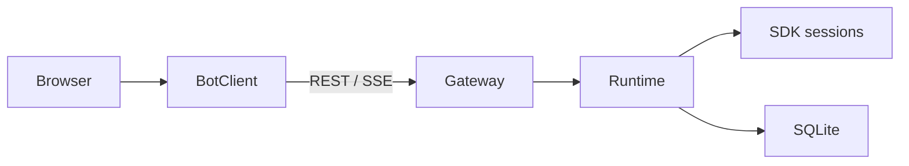

# Scream Bot operator guide

Scream Bot is a local browser workbench over the existing Scream session engine. The gateway owns
Bot metadata, conversation routing, the run queue and the browser's transcript projection. It uses
one SDK harness and a full main session per thread, not a separate engine or specialist Bot types.



The workspace is the session's working directory, not a sandbox. Memory retains the existing
shared/project-scoped behavior; separate Bot names or threads do not guarantee private memory.
Core execution, permissions, profiles and MCP management remain the source of truth.

## Start the workbench

Use a Scream installation with its model/provider configuration already prepared:

```bash
scream bot
scream bot --no-open
```

The default address is `http://127.0.0.1:3210`. An empty Bot database is seeded with a Bot named
`Scream`, using the gateway process's current directory as its workspace, and an initial
conversation. Existing Bots without a conversation receive one when the database opens. Deleting
a Bot's last conversation creates a replacement; deleting the last Bot is rejected.

The gateway serves the built UI from `dist/bot-ui` when available. For source development, run
these commands from the repository root, with the gateway and Vite in separate terminals:

```bash
pnpm --filter scream-code run bot:build
pnpm --filter scream-code run bot:server --no-open
pnpm --filter scream-code run bot:dev
```

`bot:dev` requests port `5174` and proxies `/api` to port `3210`; use the port Vite actually prints.
The gateway and browser use real execution by default. Source-mode startup uses the same default
Scream home as the installed CLI. For experiments, select a separate home with the standalone
entry point's `--home` option and provide a deliberately prepared configuration rather than
modifying the user's working database. See the [UI guide](ui/README.md) for the explicit mock
preview, build and UI type-check commands.

### Installed `scream bot` options

These options are registered in `src/cli/commands.ts` and passed through `src/cli/run-bot.ts`:

| Option | Meaning / default |
| --- | --- |
| `--port <port>` | Listen port; `3210`. |
| `--model <model>` | Fallback model alias when a Bot has no model configured. |
| `--auto` | Select the existing `auto` permission mode; otherwise the launch default is `bot`. |
| `-y`, `--yolo` | Existing CLI spelling that also selects `auto` for the Bot gateway; not a third Bot tier. |
| `--no-open` | Do not launch a browser. |
| `--lan` | Bind `0.0.0.0` and enable token-checked remote API access. Default binding is `127.0.0.1`. |
| `--token <key>` | Supply the LAN gateway token; one is generated if LAN mode has no token. |
| `--idle-minutes <minutes>` | Close idle sessions after 30 minutes by default; `0` disables idle closing. |
| `--skills-dir <dir>` | Additional skill directory; repeatable. |

Gateway launch defaults do not overwrite a Bot's stored model or permission settings. In
particular, the permission option seeds the first Bot when the database is empty; it is not a
bulk permission update for existing Bots.

### Standalone source gateway options

`pnpm --filter scream-code run bot:server` runs `server/main.ts`, whose parser differs from the
installed subcommand. It accepts `--port` / `-p` (default `3210`), `--model`, `--lan`, `--token`,
`--idle-minutes`, `--no-open` and `--help` / `-h`, plus:

| Option | Meaning / default |
| --- | --- |
| `--host <host>` | Explicit bind address; otherwise `127.0.0.1`, or `0.0.0.0` with `--lan`. |
| `--permission <bot\|auto>` | Fallback permission; any other value is rejected. |
| `--home <dir>` | Explicit Scream home, including its Bot database. |
| `--config <path>` | Explicit Scream configuration file. |

For this standalone entry point, omitting `--idle-minutes` disables idle closing, and automatic
browser opening is macOS-only. It does not parse `--auto`, `--yolo` or `--skills-dir`. Do not assume
its `--host`, `--home`, `--config` or `--permission` flags are installed `scream bot` options.

### Permissions and network access

- `bot` uses the core unattended policy: allowlisted reversible work may run; other operations
  are denied/parked. This is not a new browser approval policy.
- `auto` uses the existing core automatic-approval mode, subject to higher-priority core denies.
  It does not mean "ask before dangerous commands". Choose it only when that existing contract
  is appropriate for the workspace and task.
- Loopback API connections are trusted. With `--lan`, non-loopback API requests must provide
  `Authorization: Bearer <token>` or the request's `?token=` parameter. The printed URL includes
  the token; when binding all interfaces it displays `localhost`, not a discoverable LAN address.
  The switch does not configure HTTPS or automatically propagate a page query token into every
  browser request. Keep the local binding unless remote access has been deliberately configured
  and exercised. Treat the token as a credential and do not publish the URL.

## Storage and upgrades

The Bot database is `<screamHome>/bot/bot.db`. Scream home resolution is an explicit `homeDir`
(the standalone `--home`), then `SCREAM_CODE_HOME`, then `~/.scream-code`. The configuration is
`<screamHome>/config.toml` unless an explicit configuration path is supplied. SDK session history
is separate from the Bot database; its display projection is not a replacement execution log.

`server/migrations.ts` currently declares schema version **7**. It records applied versions in
`schema_migrations` and `PRAGMA user_version`. Before upgrading an existing on-disk database, it
uses SQLite `VACUUM INTO` to create a consistent backup named
`bot.db.pre-v7-<uuid>.bak` beside the database, including committed WAL data. Fresh databases do
not need that pre-upgrade backup. Required schema changes run in a transaction; failure rolls
back and prevents the store from opening for service. A server also rejects a database with a
newer schema than it supports.

Do not copy only a live `bot.db` and ignore `bot.db-wal`. For manual backups, use SQLite's supported
consistent-backup mechanism. Before restoring, stop every gateway writer and retain the failed
database and sidecars for diagnosis. Restore a consistent pre-upgrade backup together with the
matching server version. Do not expect older code to write the newer schema safely, or discard
Bot/session data as a migration workaround.

Migration preserves existing Bot/conversation data and any stored legacy handoff answer. Legacy
unfinished handoffs without a target Run association are recorded as `failed` with a legacy
interruption/confirmation reason; they are not inferred successful from a thread's last answer
or automatically dispatched again.

## Queue and interrupted-run recovery

A normal prompt is durably accepted before dispatch. Runs on one thread execute in order until
the actual main turn completes; other threads can execute concurrently. Prompt RPC acceptance
is not turn completion. `mode: "steer"` targets the active main turn when available, rather than
creating a second concurrent turn on that thread.

`POST /api/threads/:id/messages` accepts `text`, optional `mode` (`queue` or `steer`) and an optional
`requestKey`. Reusing a key for the same thread/text returns its accepted Run; reusing it for a
different thread/text is a conflict. The API responds `202` with the Run identity, not a completed
answer.

### Launching

`scream bot` starts the gateway (default `127.0.0.1:3210`, opens the UI). Useful flags: `--port`, `--lan` (requires the printed access key), `--token`, `--yolo`, `--idle-minutes`. The gateway serves `dist/bot-ui`; rebuild with `bot:build` after UI edits.

### Attachments

Files are uploaded first, then referenced by a prompt:

- `POST /api/bots/:id/attachments` (multipart field `file`, optional `?threadId=`) stores a file in
  that Bot's workspace under `.scream-attachments/<uuid>-<name>` and returns an `Attachment`. The
  optional thread id resolves the workspace exactly as that thread's runs would.
- `POST /api/rooms/:id/attachments` stores the same file, under the same relative path, in **every
  member workspace**, so any addressed Bot can open it.
- Limits: 25 MB per file and 10 files per message. The body is rejected before multipart parsing
  when `Content-Length` already exceeds the limit. Names keep letters and digits from any script;
  other characters become `_`, and the path always carries a server-generated UUID prefix.
- Bot identity: `avatarEmoji` (≤8 graphemes) and `accentHue` (0-359) drive the avatar and the tinted message card (schema v7 columns `avatar_emoji`, `accent_hue`).
- Prompts accept `attachments` (the returned objects). Only paths the server issued are accepted.
  The turn sees a trailing "Attached files" list of workspace-relative paths; the transcript keeps
  the person's text plus attachment chips. A retried send reuses the same attachments.

On startup, recovery distinguishes work that can be proved unstarted from work whose effects
are unknown:

| Persisted state | Startup behavior |
| --- | --- |
| Complete prompt input, `queued`, no `dispatch_started_at` | Eligible to resume through the thread queue, subject to pause/deletion and interruption gates. |
| `running`, `waiting_user`, an observed Run, missing legacy input, or a dispatch boundary already recorded | Mark `interrupted` and block that thread's queue. Do not automatically replay. |
| Pending approval/question from the previous process | Expire it; the old in-memory callback cannot be answered after restart. |

The interrupted record retains its error and is not rewritten as successful. Read the original
Run and inspect its transcript and workspace before deciding whether an operation already took
effect. A different thread is not blocked by this thread's interruption.

### Recovery API

Inspect `GET /api/runs/:id` (or list via `GET /api/runs?threadId=...`). A thread exposes
`blockedByRunId` when an unresolved interrupted Run gates its queue. Record a deliberate decision
with **`POST /api/runs/:id/recovery`**, using a JSON body with exactly one of these decisions:

| `decision` | Effect |
| --- | --- |
| `continue_queue` | Leave the uncertain Run interrupted and allow remaining queued work once this thread has no other unresolved interruption. Do not rerun the uncertain input. |
| `retry` | Explicitly authorize a new Run from the saved input, linked by `retryOfRunId`. The original remains interrupted. Runs without replayable input cannot be retried. |
| `cancel_queue` | Cancel the thread's queued Runs and resolve this interruption's gate; the original interrupted record remains. |

The response is `{ run, retryRun }`; `retryRun` is `null` unless a retry was created. Repeating the
same decision is idempotent and returns the same retry identity. A conflicting later decision
returns a conflict instead of creating another execution. A retry can repeat external side
effects: it is an operator decision, not evidence that the first attempt did nothing. Check
existing queued work before releasing the gate; creating a retry does not give it priority over
older queued Runs. Additional unresolved interruptions keep the thread blocked.

An undispatched queued Run can instead be cancelled with `POST /api/runs/:id/cancel`. To request
that the live turn stop, use `POST /api/threads/:id/interrupt`; a cancellation acknowledgement
alone is not proof that the turn has ended.

## Identity, collaboration and rooms

Each turn receives a runtime-only identity block: the Bot's own name and id, the effective thread
workspace, and the other Bots it can contact. The base Scream prompt is never replaced. Tool,
model, thinking and permission changes are applied from the stored Bot record before the next run;
a thread records the config revision it actually applied. Changing a role that is pinned in an
older session, or changing the default workspace, applies to a new thread — existing conversations
keep their directory. Bot memory is the shared Scream experience library, not per-Bot isolation.

`message_bot` has two actions: `list` returns the contactable Bots (stable ids, paused state);
`send` hands over work. A hand-off is bound to the concrete target Run it created, one hop deep and
at most three per source Run. When the target finishes, the answer is stored as `awaiting_relay`;
a separate relay Run lands it back in the source conversation, and only then does the hand-off
become `delivered`. A relay Run cannot hand off again. Queued hand-offs may resume after restart;
targets that had already started and whose outcome is unknown become `interrupted` and are never
replayed automatically. Legacy hand-offs with no target Run are marked failed during upgrade.

Rooms send the bounded shared transcript (recent 40 messages / ~12k characters) with the new
message, so a Bot addressed second can see what the first one said. Members stream a live draft into
the room (`room.delta`) while they work, and the persisted reply lands when the run ends.
`GET /api/rooms/:id/messages`
returns `{ messages, runs }`: the pure transcript plus the member runs behind it, so the room can
show real queued/running/waiting/failed progress. `POST /api/rooms/:id/messages`
accepts an optional `requestKey`; the same key and text returns the existing room message and does
not duplicate member Runs.

## Browser state and reconnects

`GET /api/threads/:id/messages` returns `{ threadId, version, messages }`. Transcript IDs and
projection versions reconcile persisted history with in-flight output; equal text does not
identify a message, and legacy unknown timestamps remain `null`.

`GET /api/events` is the SSE endpoint. Each event carries a process `epoch` and a globally ordered
`seq`, with `id: epoch:seq`. Reconnect using `Last-Event-ID` (the gateway also accepts `lastEventId`
as a query parameter). The replay buffer is process-local and holds 500 events by default; it is
not durable run history. An invalid cursor, changed epoch, future sequence or buffer gap triggers
`resync`. Reconcile all query domains, including inactive Bots, Inbox, rooms, activity and files.
A stream snapshot is a checkpoint, not proof that every query domain is already synchronized.

## Engineering checks

From the repository root, the package scripts define these build/type-check entry points:

```bash
pnpm --filter scream-code run typecheck
pnpm --filter scream-code run bot:build
pnpm exec vitest run --project cli apps/scream-code/test/bot/server
```

The server tests cover scheduling, transcript projection, recovery, migrations and gateway
behavior. `test/bot/server/sdk-integration.test.ts` exercises the actual harness/session/RPC path
with a controlled local model endpoint and a temporary home; it is not a live-provider test.
Use the [UI guide](ui/README.md) for browser transport and cache boundaries. Commands here describe
how to run checks, not a claim that any particular workspace revision has passed them.
